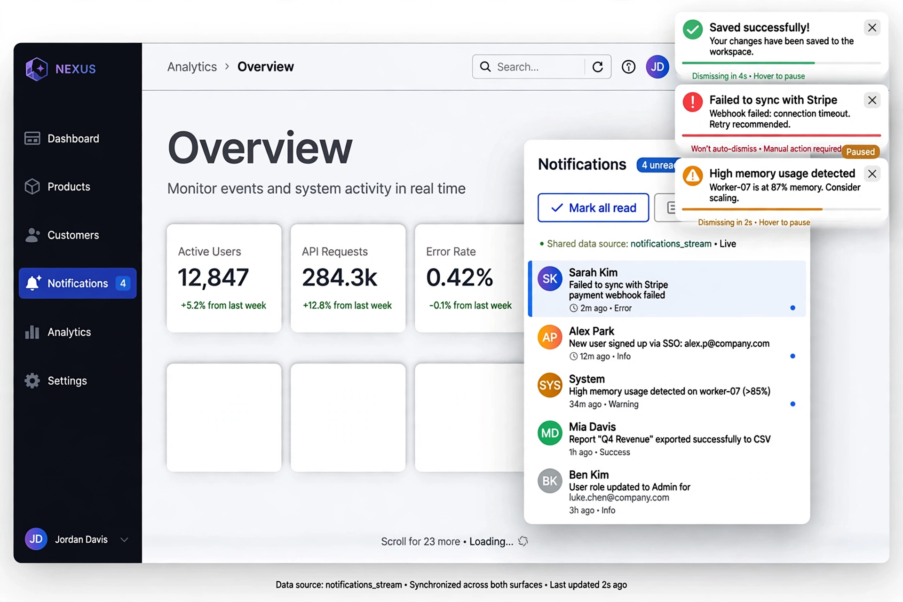
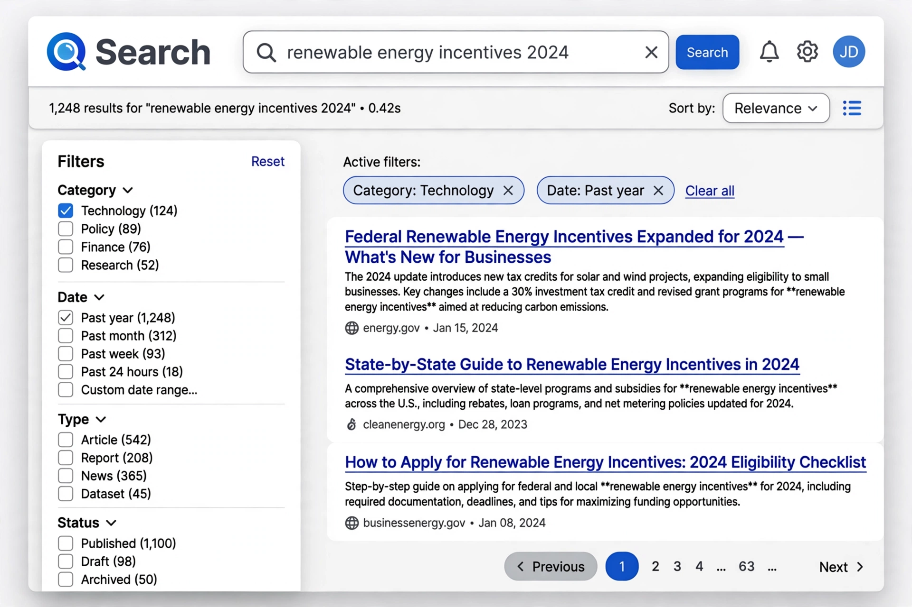

# SaaS后台

## Linear 风 SaaS 数据后台 (`saas-dashboard-linear`)

- 风格：极简 / 深色 / 专业
- 场景：项目管理/协作类 SaaS 首页仪表盘
- 适用工具：v0、Lovable、Cursor

**EN prompt（复制用）**

```
Design a clean SaaS analytics dashboard in the style of Linear: dark sidebar navigation, light content area, compact data tables, KPI cards with sparklines, a line chart and a bar chart, status badges, subtle borders instead of heavy shadows, 8px spacing system, Inter font, primary color indigo #5E6AD2, rounded-lg corners, professional and information-dense but uncluttered.
```

**中文说明**：Linear 风极简 SaaS 仪表盘：深色侧边栏、紧凑表格、KPI 卡片+迷你趋势图、状态徽章、细边框少阴影、靛蓝主色、信息密集但不乱。

## 浅色企业管理系统 (`saas-admin-light`)

- 风格：浅色 / 企业级 / 表格密集
- 场景：订单/用户/权限等后台管理 CRUD
- 适用工具：v0、Cursor、Qoder

**EN prompt（复制用）**

```
Build an enterprise admin panel UI: top header with search and user avatar, left collapsible menu, breadcrumb, filter bar with date range and dropdowns, a paginated data table with row selection, status pills and action buttons, a slide-over detail drawer and a modal form. White and light gray palette, blue primary #1677FF, clear hierarchy, designed for daily heavy use, no decorative gradients.
```

**中文说明**：企业级浅色后台：顶栏+可折叠菜单、筛选条、分页表格、状态标签、详情抽屉和弹窗表单，蓝色主色，耐看实用不要花哨渐变。

## 看板协作工具 (`saas-kanban`)

- 风格：卡片 / 协作 / 彩色标签
- 场景：任务看板/项目进度管理
- 适用工具：v0、Lovable

**EN prompt（复制用）**

```
Create a Kanban project board UI like Trello/Linear: horizontal columns (Backlog, In Progress, Review, Done) with drag-ready cards, each card shows title, colored labels, assignee avatars, due date and comment count; top bar with board switcher, filter and members; soft gray background #F4F5F7, white cards with subtle shadow, friendly but professional.
```

**中文说明**：看板协作 UI：横向列+可拖拽卡片，卡片带彩色标签、成员头像、截止日期，浅灰底白卡片。

## 设置页主从布局 (`saas-settings-master-detail`)


生成验证：✅ 2026-11-17 通过 — 生成图为设置页：左侧六项导航 Notifications 高亮，右侧分组卡片行式设置（左标题说明、右开关/下拉），底部 Unsaved changes 吸底条与红色 Danger zone 卡片均出现，通过

- 风格：主从布局 / 表单 / 设置
- 场景：产品设置/账户/团队管理页
- 适用工具：v0、Cursor、Lovable

**EN prompt（复制用）**

```
Design a settings page in a master-detail layout: left vertical nav (Profile, Account, Notifications, Billing, Security, Team) with the active item highlighted; right panel shows the active section as grouped cards, each setting as one row — title and helper text on the left, the control (toggle, select or button) on the right, comfortable 56px row height. Save per section and show a sticky 'Unsaved changes' bar at the bottom only when edits are pending. Put destructive actions in a separate red-bordered 'Danger zone' card at the very bottom. Calm neutral palette, one accent, no endless ungrouped scroll.
```

**中文说明**：设置页主从布局：左侧分组导航、右侧按卡分组的设置行（标题+说明+右侧控件）、有改动才吸底保存条、危险操作单独红框放最底。

## SpicyTater：后台菜单交互 8 类选型 (`spt-admin-menu`)


生成验证：✅ 2026-11-19 通过 — 生成图为 Orbit 后台：滑动高亮块选中 Dashboard、Projects 就地展开子菜单、顶部页签带高亮、⌘K 命令面板搜索条、Inbox 12 徽标+状态点、底部悬浮停靠栏齐全，通过

- 风格：后台菜单、交互选型、章节摘录
- 场景：做后台/侧栏导航菜单，不知道用哪种展开方式时
- 适用工具：v0、Lovable、Cursor

**EN prompt（复制用）**

```
Choose admin menu patterns by structure: sliding highlight block for sidebar nav and top tabs; expand-in-place submenus for hierarchical project/file trees; top drop-down panel when there are few sections but multiple entries (mouse and keyboard); floating bottom dock for frequent entries (magnify on hover, neighbours make room); command palette when entries are many (search + keyboard selection); status dots and count badges for new messages and pending items, animating the number when it changes. Pick the combination by section count, hierarchy depth and usage frequency; entries must stay obvious and reachable.
```

**中文说明**：SpicyTater 第22集（2062赞）：滑动高亮块/就地展开/顶部下落面板/底部悬浮停靠栏/命令面板/状态点徽标等 8 类后台菜单，按栏目数量、层级、频率选组合。

## 费纸张：设置页三步排版（原作版） (`saas-settings-three-steps`)


生成验证：✅ 2026-11-22 通过 — 生成图为 Acme 设置页：一项一行（左名右控件）、无最外层卡片框、Profile/Notifications/Billing 分组加标题且组间留白大于组内、行间细线分隔，三步全部呈现，通过（Timezone 一处拼写为 Tizezone，小瑕疵）

- 风格：设置页、排版、原作摘录
- 场景：AI 做的设置页杂乱、框套框时
- 适用工具：v0、Lovable、Cursor

**EN prompt（复制用）**

```
Lay out this settings page in three steps: 1) one setting per row — name on the left, control on the right; 2) remove the outermost frame — the page itself needs no extra card wrapper; 3) group settings under group titles with generous spacing between groups, tight spacing within groups and only hairline dividers between rows. Note: for registration/checkout forms instead put labels above full-width inputs, in fill order, leaving room for error messages and longer content.
```

**中文说明**：费纸张第5集原作三步：一项一行（左名右控件）、去掉最外层框、分组加标题（组间多留白、组内少留白、行间细线）；并对比表单场景：名称在上、全宽输入。与设置页主从布局同属设置页风格组。

## 登录页：社交登录优先+单主按钮 (`auth-login-page`)


生成验证：✅ 2026-11-26 通过 — 生成图为 SaaS 登录页：Google/Apple/GitHub 三按钮在前、Passkey/Magic Link、or with email 分隔线、邮箱+单个密码框带显示切换、密码旁 Forgot password?、具体报错文案'That password is not right. Reset it'、蓝色 Log in 主按钮带加载态'Logging in...'、按钮下隐私说明与 New here? Create an account 链接、左上 Back to site，中性底+单强调色、无紫色渐变，通过

- 风格：登录 / 表单 / 极简
- 场景：做登录页、默认模板总把注册和登录混在一起时
- 适用工具：v0、Lovable、Cursor

**EN prompt（复制用）**

```
Design a login page for a SaaS product: sign-in providers first — Google, Apple and GitHub buttons plus a passkey/magic-link option above an 'or with email' divider, so most returning users never type a password. The form: email and one password field with a show-password toggle; no confirm-password field. One primary action: a single solid Log in button; demote sign up to a quiet 'New here? Create an account' link. A 'Forgot password?' link right beside the password field. Specific error copy ('That password is not right. Reset it') and a loading state on the button. Style: neutral base, one accent color on the primary button only, named headline/body typefaces, no purple gradient. A short privacy note under the button and a clear path back to the marketing site.
```

**中文说明**：登录页：社交/密钥登录放最前、邮箱+单个密码框带显示切换、一个 Log in 主按钮、注册降级为链接、密码旁放找回链接、写清具体报错与加载态，中性底+单强调色。
## 通知中心+Toast 双面系统 (`saas-notification-center`)



生成验证：✅ 2026-11-28 通过 — 生成图为 SaaS 通知双面系统：右上堆叠 Toast 三种类型（成功/错误/警告，各带强调色与图标、2px 倒计时进度条、悬停暂停提示、错误不自动消失、Paused 徽标）+ 持久通知中心（4 未读角标、Mark all read、头像+相对时间+已读/未读圆点、Scroll for 23 more），两面共用 notifications_stream 数据源，通过（小瑕疵：Toast 与通知中心面板重叠处“4 unread”角标被部分遮挡、底部三张 KPI 卡为空白；不影响验证特征）

- 风格：通知 / Toast / 消息中心
- 场景：SaaS 产品需要既即时提醒又可回查的通知系统时
- 适用工具：v0、Lovable、Cursor

**EN prompt（复制用）**

```
Build a notification system as two surfaces sharing one data source: (1) ephemeral toasts — stacked vertically top-right with 10px gaps, four types (success, error, warning, info) each with its own accent color, icon, title and message; a 2px auto-dismiss progress bar at the bottom of each toast shrinking from 100% to 0% over its duration, hover pauses the countdown, errors never auto-dismiss, each toast has a close button and a simple show API. (2) a persistent notification center — a panel listing every event with read/unread state, actor avatar, relative time, unread count badge, mark-read and mark-all-read actions, and infinite scroll. Keep the visual language consistent across both surfaces and announce new toasts to screen readers without stealing focus.
```

**中文说明**：通知双面系统：右上堆叠 Toast（四种类型各有强调色、2px 倒计时进度条、悬停暂停、错误不自动消失）+ 持久通知中心（已读/未读态、未读角标、一键已读、无限滚动），两面共用同一数据源。
## 搜索结果页：筛选侧栏+已选 chips (`search-results-filters`)



生成验证：✅ 2026-11-28 通过 — 生成图为搜索结果页：顶部搜索框+查询词与 1,248 results 计数、左侧筛选侧栏（Category/Date/Type/Status 可折叠分组带数量）、已选条件 chips 可逐个移除+Clear all、结果列表关键词加粗、Sort by Relevance 排序与分页，通过（小瑕疵：摘要中匹配词两侧出现字面 ** 标记；不影响验证特征）

- 风格：搜索 / 筛选 / 列表
- 场景：做内容/商品/文档搜索结果页，需要侧栏筛选时
- 适用工具：v0、Lovable、Cursor

**EN prompt（复制用）**

```
Design a search results page with a filter sidebar: a search bar at the top with the query and result count ('128 results for "…"'); a left filter sidebar with collapsible checkbox groups (category, date, type, status), each group showing counts; active filters shown as removable chips above the results with a 'Clear all' action; results as a clean list (title, snippet with the matching text in bold, source and date) or an image grid toggle; a sort control (relevance/newest) and pagination or infinite scroll. On mobile the sidebar collapses into a filter button opening a bottom sheet. Full keyboard navigation, visible focus, and never let filters push results below the fold on desktop.
```

**中文说明**：搜索结果页：顶部搜索框+结果数、左侧可折叠复选框筛选分组（带数量）、已选条件以 chips 显示可逐个移除+清空全部、结果列表关键词加粗或图片网格切换、排序与分页，移动端筛选项收进底部浮层。
