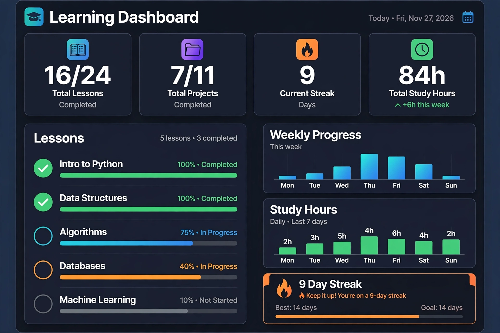

# 在线教育

## 在线学习仪表盘：进度+连胜+学习时长 (`edu-learning-dashboard`)



生成验证：✅ 2026-11-28 通过 — 生成图为深色学习仪表盘：顶栏标题+今日日期、四张数据卡（16/24 课时、7/11 项目、9 天连胜、84h 学习时长）、左侧课程列表带动画进度条与完成勾选、右侧周进度与学时图表+9 天连胜计数，通过

- 风格：学习仪表盘 / 进度 / 深色
- 场景：做在线课程/学习平台的个人学习进度仪表盘时
- 适用工具：v0、Lovable、Cursor

**EN prompt（复制用）**

```
Build a learning progress dashboard: a header with the title 'Learning Dashboard' and today's date; a stats row of 4 cards at the top — total lessons completed (out of 24), total projects completed (out of 11), current streak in days, and total study hours — each card with a large number, a label and a small icon; below, two side-by-side sections: on the left a lesson list with animated progress bars and completion checkmarks, on the right weekly progress and study-hours charts plus a streak counter that tracks consecutive days of activity. Use a dark theme with clean modern styling and clear visual hierarchy, progress bars animate on load, and keep the layout scannable at a glance.
```

**中文说明**：学习仪表盘：顶栏标题+今日日期、四张数据卡（已完成课时/项目/连续天数/学习时长）、左侧课程列表带动画进度条、右侧周进度与学时图表+连胜计数，深色主题、层级清晰、一眼可读。
