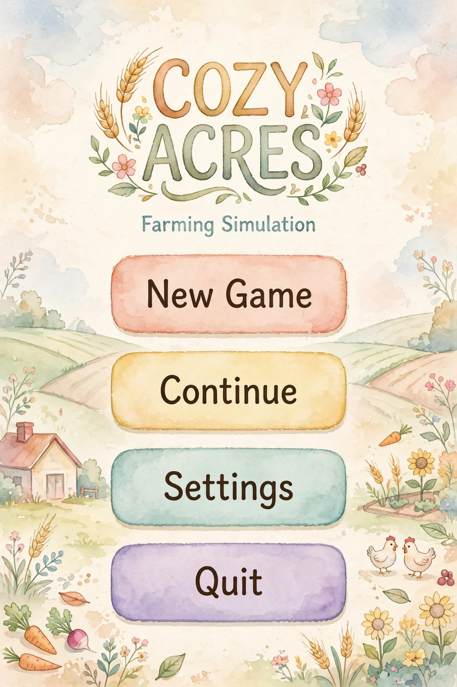

# 游戏娱乐

## 科幻射击游戏 HUD：血条/弹药/小地图 (`game-hud-scifi`)


生成验证：✅ 2026-11-25 通过 — 生成图为科幻射击 HUD：左上血条 92%+护甲 75%、右上雷达小地图、右下弹药 48/120，全息蓝发光边缘+透明面板+未来感无衬线字体，深色星空背景清晰可读，通过（小瑕疵：血条面板底部'SUIT INTEGRITY: STABLE'一行有 faint 重影，不影响主体）

- 风格：游戏UI / HUD / 科幻 / 全息
- 场景：做科幻射击游戏，需要血条、弹药、小地图一目了然的全息 HUD 时
- 适用工具：即梦、Midjourney、v0

**EN prompt（复制用）**

```
Design a sci-fi shooter HUD. Include health bar in top-left, ammunition counter in bottom-right, minimap radar in top-right corner. Holographic blue style with glowing edges, transparent panels, futuristic sans-serif typography. Clean and readable against dark backgrounds.
```

**中文说明**：科幻射击 HUD：左上血条、右下弹药、右上雷达小地图，全息蓝发光边缘+透明面板，未来感无衬线字体，深色背景上清晰可读。

## 休闲农场模拟游戏主菜单 (`game-main-menu-cozy`)



生成验证：✅ 2026-11-25 通过 — 生成图为休闲农场游戏主菜单：顶部居中'COZY ACRES / Farming Simulation' Logo，下方竖排 New Game/Continue/Settings/Quit 四键，柔和粉彩+圆角+手绘水彩质感，农舍/母鸡/向日葵田园场景温暖治愈，通过

- 风格：游戏UI / 主菜单 / 休闲 / 手绘
- 场景：做休闲模拟经营游戏，需要温暖治愈的主菜单时
- 适用工具：即梦、Midjourney、v0

**EN prompt（复制用）**

```
Create a main menu for a cozy farming simulation game. Centered game logo at top, vertical button stack below: New Game, Continue, Settings, Quit. Soft pastel colors, rounded corners, hand-painted style with watercolor textures. Warm and inviting atmosphere.
```

**中文说明**：休闲农场游戏主菜单：顶部居中 Logo，下方竖排新游戏/继续/设置/退出，柔和粉彩+圆角+手绘水彩质感，温暖治愈。
