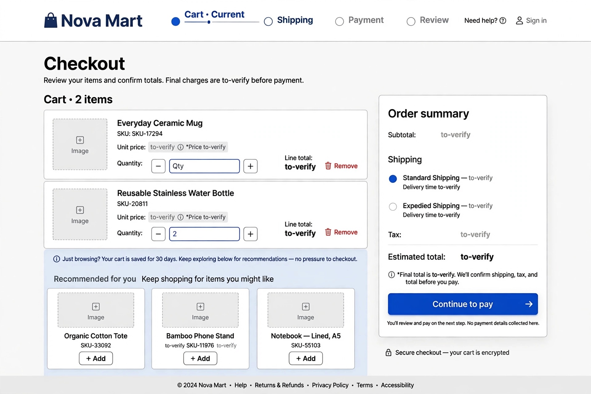

# 电商零售

## 时尚电商小程序 (`ecom-fashion`)

- 风格：时尚 / 图片主导 / 极简
- 场景：服装/美妆电商首页与商品详情
- 适用工具：v0、即梦

**EN prompt（复制用）**

```
Design a fashion e-commerce mobile UI: clean white background, top search and category tabs, full-bleed model photography in a 2-column product grid, product name, price and discount tag in small refined type, product detail page with swipeable gallery, size selector chips, sticky add-to-cart bar. Black/white/gray palette, premium minimal aesthetic like COS/Zara apps.
```

**中文说明**：时尚电商：模特大图双列网格、小字价格排版、详情页图集+尺码 chips+吸底加购条，黑白灰高级极简。

## 商家经营后台 (`ecom-dashboard-store`)

- 风格：数据 / 浅色 / 卡片
- 场景：电商商家数据/订单后台
- 适用工具：v0、Cursor、Qoder

**EN prompt（复制用）**

```
Build an e-commerce merchant dashboard: revenue overview cards (GMV, orders, conversion, refund rate) with day-over-day deltas, sales trend area chart, top products ranking table, pending orders and low-stock alerts panel, channel breakdown donut chart. Light theme, teal primary color, dense but scannable, designed for shop owners checking numbers every morning.
```

**中文说明**：商家经营后台：GMV/订单/转化/退款四卡片带环比、销售趋势、热销排行、待处理订单与库存预警，青绿主色。

## 电商结账：购物车到支付 (`ecom-checkout-flow`)



生成验证：✅ 2026-11-27 通过 — 生成图为桌面结账页：瘦顶栏 Cart 当前/Shipping/Payment/Review 四步、商品行（图占位/名/SKU/单价/数量步进/小计/Remove）、汇总卡（小计/运费选项/税/预估总价均标 to-verify）、Continue to pay 主按钮、空购物车挽留条与推荐商品、无真实支付字段、金额不确定处均标 to-verify，通过（小瑕疵：首件商品数量框显示 Qty 占位而非数字）

- 风格：结账 / 电商 / 转化
- 场景：做电商购物车/结账/订单确认页时
- 适用工具：v0、Lovable、Cursor

**EN prompt（复制用）**

```
Design a cart-to-pay checkout page for an online store: a slim checkout header (Cart current, no marketing nav); line items with image placeholder, name, SKU, unit price, quantity stepper, line total and remove; a summary card with subtotal, shipping options, tax line and estimated total; one primary Continue to pay button; an empty-cart state with a reason to stay and recommendations. Keep money honest: mark any unverified price, tax or shipping figure as to-verify instead of inventing it; no real payment fields on the cart screen. Semantic accessible markup, visible focus, labeled inputs.
```

**中文说明**：电商结账：瘦顶栏+商品行（图/名/SKU/单价/数量/小计/删除）+汇总卡（小计/运费/税/预估总价）+继续支付主按钮+空购物车挽留态；金额不确定的标待核对、不编造。
