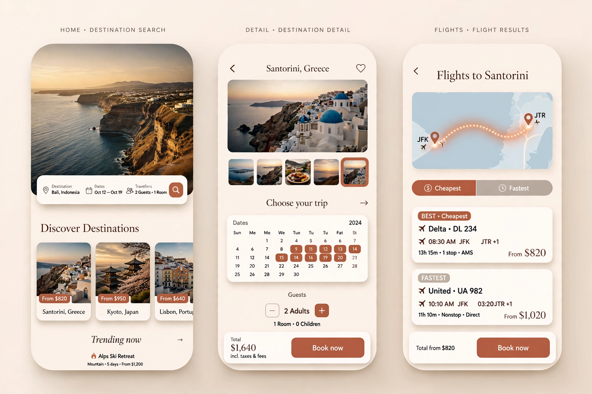

# 移动端App

## 移动端金融 App (`mobile-fintech`)

- 风格：深色 / 高级感 / 数字突出
- 场景：钱包/记账/理财 App 首页
- 适用工具：v0、Midjourney、即梦

**EN prompt（复制用）**

```
Design a premium mobile fintech app home screen (390x844): dark navy background, total balance in large bold numerals, income/expense summary, quick action row (transfer, pay, top-up, more), a spending chart card, recent transactions list with merchant icons. Gold accent #D4AF37 used sparingly, glassmorphism cards, smooth rounded corners 20px, trustworthy and luxurious feel.
```

**中文说明**：高级感金融 App 首页：深海军蓝底、余额大数字、快捷操作、支出图表卡、交易列表，金色点缀+玻璃拟态卡片。

## 健康运动 App (`mobile-health`)

- 风格：清新 / 圆环 / 浅色
- 场景：运动记录/健康数据 App
- 适用工具：v0、Lovable、即梦

**EN prompt（复制用）**

```
Create a fresh mobile health app UI: light background, greeting header with avatar, activity rings showing steps/calories/distance, weekly bar chart, sleep and heart-rate cards with soft gradients (mint green, sky blue, lavender), large rounded cards, playful micro-illustrations, SF Pro style typography, encouraging and clean.
```

**中文说明**：清新健康 App：活动圆环、周数据柱状图、睡眠/心率卡片，薄荷绿+天蓝柔和渐变，大圆角，干净治愈。

## 外卖点餐 App (`mobile-food`)

- 风格：食欲感 / 暖色 / 图片主导
- 场景：外卖/点餐类 App 首页与点单页
- 适用工具：v0、即梦、Midjourney

**EN prompt（复制用）**

```
Design a food delivery app: warm off-white background, location header and search bar, horizontal category chips with food icons, large appetizing food photo cards with rating, delivery time and price, sticky cart bar at bottom showing total and checkout button. Orange-red primary #FF4D2E, big imagery, minimal text, fast scanning layout for hungry users.
```

**中文说明**：外卖 App：大图食物卡片、分类 chips、评分/时效/价格，底部吸底购物车条，橙红主色，食欲感优先、文字极少。

## 新手引导：4 步可跳过流程 (`mobile-onboarding-flow`)


生成验证：✅ 2026-11-18 通过 — 生成图为4步引导同屏：每屏一插图、标题≤4词、正文≤20词讲收益、单一主按钮、右上角常驻Skip、按钮上方进度点、第4步通知开关+Get started且标注进度已保存可续做，通过

- 风格：新手引导 / 流程 / 转化
- 场景：新用户首次打开 App，需要讲清价值并引导完成关键设置时
- 适用工具：v0、Lovable、Cursor

**EN prompt（复制用）**

```
Design a 4-step mobile onboarding flow: each screen has one full-bleed illustration or product visual, a headline of at most 6 words, body copy of at most 20 words focused on the user's benefit (not features), and a single primary button; a 'Skip' link is always visible in the top corner and skipped steps are recorded. Progress dots sit above the button; step 4 ends on the one setup action that matters most (e.g. enable notifications or pick interests) with a 'Get started' button. Use the app's real brand color and type scale, keep copy short and warm, and make the whole flow resumable if the user leaves mid-way.
```

**中文说明**：4 步新手引导：每屏一图一标题（≤6 词）一短文案（≤20 词、只讲用户收益）、常驻跳过入口、进度点+最后一屏落到关键设置动作，可中途退出续做。

## 旅行预订 App：沉浸式搜索+预订 (`mobile-travel-booking`)



生成验证：✅ 2026-11-25 通过 — 生成图为三屏旅行预订：首页大图+底部搜索条（目的地/日期/人数）+目的地横滑卡片含起价+Trending now 行；详情页照片墙+日期选择+人数步进+底部常驻总价 $1,640 与 Book now；航班页发光路线图 JFK→JTR+最便宜/最快切换，衬线标题+陶土强调色齐全，通过（小瑕疵：详情页日历星期缩写有个别拼写错乱，不影响功能特征）

- 风格：旅行预订 / 沉浸式 / 图片主导
- 场景：做机票/酒店预订 App，想要图片主导的沉浸式预订流程时
- 适用工具：v0、Lovable、Cursor

**EN prompt（复制用）**

```
Design a mobile travel booking app: home opens with a large immersive destination photo and a clean search bar (destination, dates, travellers) overlaid at the bottom; below, horizontally scrolling destination cards with price-from labels and a 'Trending now' row. Tapping a destination opens a detail screen with a photo gallery, a date picker, guest stepper and a sticky bottom bar showing total price and a single 'Book now' button. Flight results show a glowing route line on a small map, departure/arrival times and one clear cheapest-fastest toggle. Use elegant serif headlines with clean sans-serif body text, warm neutral palette with one terracotta accent, generous whitespace, 16px corner radius on cards. Every step must answer in one tap — no dead-end screens.
```

**中文说明**：旅行预订 App：大图沉浸式首页+底部搜索条、目的地横滑卡片、详情页含日期选择与常驻总价预订栏，航班结果带路线图与最便宜/最快切换，衬线标题+陶土强调色。
