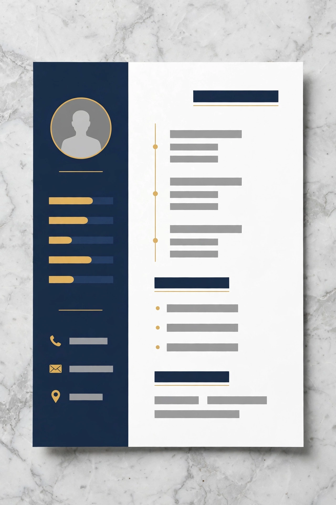
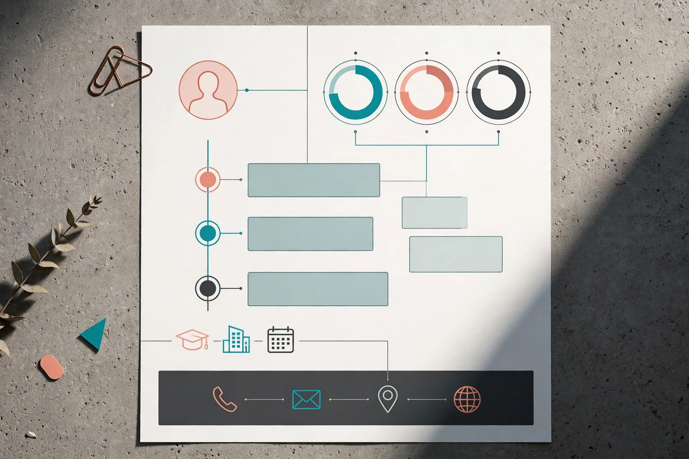

# 简历文档

## 极简双栏简历模板：照片+技能条+时间线 (`doc-resume-minimal`)



生成验证：✅ 2026-11-26 通过 — 生成图为极简双栏简历：A4 平铺于浅灰大理石面，左侧藏青边栏圆形照片占位（金圈）+金色技能条+电话/邮件/地址图标，右侧标题区（藏青标题条+细金线）+金色时间线圆点条目，无可读正文、无水印，通过

- 风格：简历 / 双栏 / 极简 / 模板
- 场景：做求职简历模板，需要专业干净的双栏 A4 版式时
- 适用工具：即梦、Midjourney、GPT Image

**EN prompt（复制用）**

```
A single A4 resume template design viewed from directly above on a light gray marble surface. Clean two-column layout: left sidebar with circular profile photo placeholder, skill bars, and contact icons; right main area with section headers and timeline entries. Professional navy blue and white color scheme with thin gold accent lines. Modern sans-serif typography placeholder blocks. Crisp flat lay photography with even studio lighting and subtle paper shadow. No readable text, no watermark.
```

**中文说明**：极简双栏简历模板：A4 平铺俯拍，左侧圆形照片占位+技能条+联系方式，右侧标题区+时间线条目，藏青白配色+细金线，现代无衬线字体占位块。

## 信息图风格简历：环形技能图+时间线 (`doc-resume-infographic`)



生成验证：✅ 2026-11-26 通过 — 生成图为信息图风格简历：A4 一页置于水泥桌面，顶部技能环形进度图三枚（青/珊瑚/炭），中部时间线（竖线+彩色圆点+条目块），底部图标联系区（电话/邮件/地址/网站），青/炭/珊瑚配色、细线连接各区、单侧柔和阴影，无可读正文、无水印，通过（小瑕疵：页面为横向 A4，提示词未限定竖版，不影响特征）

- 风格：简历 / 信息图 / 创意 / 模板
- 场景：做创意岗简历，想要信息图风格一页讲清经历与技能时
- 适用工具：即梦、Midjourney、GPT Image

**EN prompt（复制用）**

```
A creative infographic-style resume design on a single A4 page, viewed from above on a concrete desk surface. Visual elements include circular progress charts for skills, timeline graphics for work experience, and icon-based contact section. Modern color palette of teal, charcoal, and soft coral. Clean geometric layout with generous white space. Thin lines connecting sections. Flat lay photography with directional lighting creating soft shadow on one edge. No readable text, no watermark.
```

**中文说明**：信息图风格简历：A4 一页，技能环形进度图+经历时间线+图标联系区，青/炭/珊瑚配色，几何布局大留白，细线连接各区。
