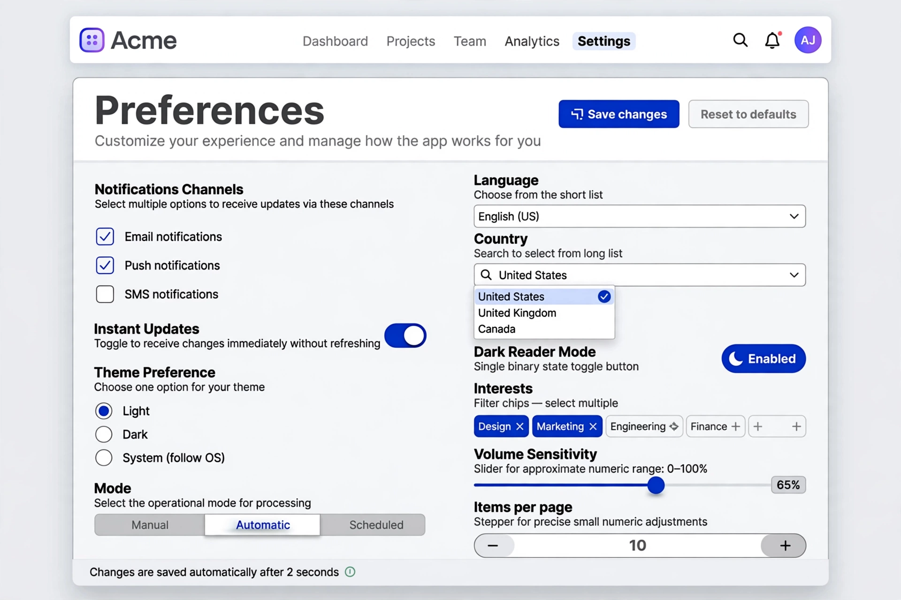
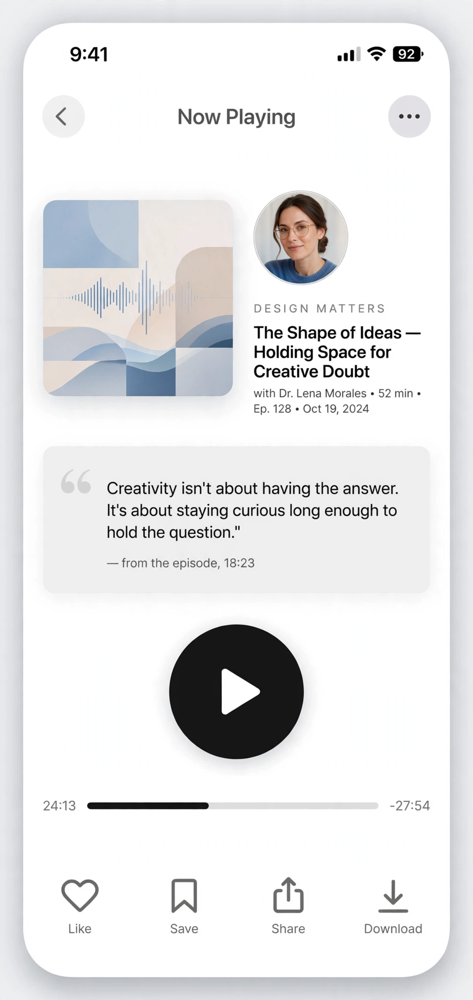
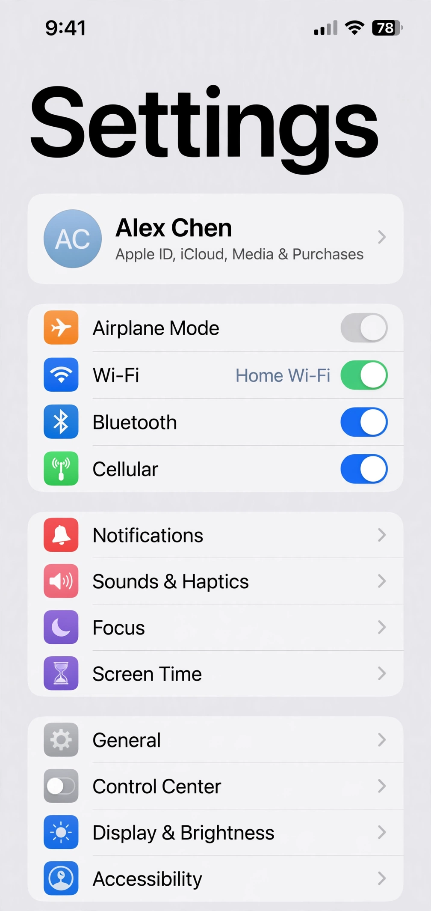
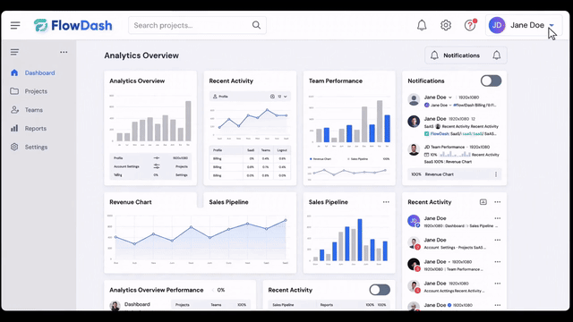
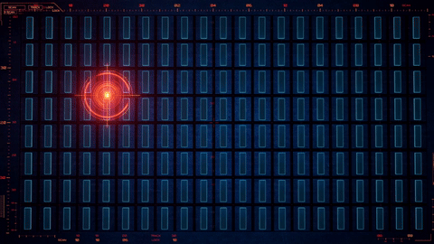
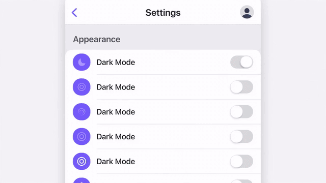

# 细节优化

## 间距节奏：8pt 网格呼吸感 (`detail-spacing-rhythm`)


生成验证：✅ 2026-11-17 通过 — 生成图为项目管理后台：分组间距分明、卡片内边距一致、标题与主按钮周围留白充足，通过

- 风格：间距 / 极简 / 秩序感
- 场景：任何界面显乱/挤时的间距优化改版
- 适用工具：v0、Lovable、Cursor

**EN prompt（复制用）**

```
Refine this UI's spacing to feel calm and premium: use a strict 8pt spacing system (8/16/24/32/48), group related elements tightly and separate groups generously, align everything to a clear grid, increase whitespace around headings and primary actions, keep card padding consistent at 24px, and remove any random one-off margins. Same content and colors, only spacing and alignment change.
```

**中文说明**：只改间距：严格 8pt 系统、组内紧组间松、卡片内边距统一 24px、标题和主按钮周围留白加大，内容配色不动，界面立刻显贵。

## 配色克制：一主色 + 中性灰 (`detail-color-restraint`)


生成验证：✅ 2026-11-17 通过 — 生成图为电商后台 ShopAdmin：仅蓝色主色+中性灰，红色只出现在错误徽章，通过

- 风格：配色 / 克制 / 高级感
- 场景：界面花花绿绿/像模板时的配色收敛
- 适用工具：v0、Lovable、Cursor

**EN prompt（复制用）**

```
Recolor this UI to look more designed: keep exactly one primary brand color, one accent for warnings/errors only, and build everything else from a neutral gray scale (text #1A1A1A, secondary #666, borders #E5E5E5, background #FAFAFA); remove all decorative gradients and rainbow icon colors; colored elements must mean something (status, action, selection), never decoration.
```

**中文说明**：配色收敛到一个主色+一个警示色，其余全用中性灰阶；删掉装饰性渐变和彩虹图标，颜色只表达状态/操作/选中。

## 费纸张5细节合集（原作版） (`detail-feizhang-five`)


生成验证：✅ 2026-11-17 通过 — 生成图为带侧边栏的分析后台：KPI 大数字、折线图、表格、嵌套卡片柔和阴影，五件套特征可见，通过

- 风格：细节 / 原作摘录 / 合集
- 场景：生成任何界面时一次性交代5个易忽视细节
- 适用工具：v0、Lovable、Cursor

**EN prompt（复制用）**

```
Pay attention to these 5 small details that make AI-generated UI feel comfortable: (1) tabular numbers — use font-variant-numeric: tabular-nums so digits never jitter; (2) concentric corner radius — outer radius = inner radius + padding (e.g. border-radius: calc(20px + 16px)), never the same radius inside and out; (3) staggered entrance — split the entrance into icon, title, body and button, appearing one after another with ~100ms stagger; (4) balanced headline wrapping — text-wrap: balance on headings so no orphan word sits alone on the last line; (5) shadows instead of borders — replace 1px solid borders with soft multi-layer box-shadows for natural edges.
```

**中文说明**：源自抖音 @费纸张《5个小细节让AI设计的界面看着更舒服》（AI设计技巧分享第3集，2026-10-21，作品 7699104647889423667，2026-11-17 已核对画面/字幕/文案）。五件套一次交代：等宽数字、同心圆角、错开入场、标题平衡换行、阴影代替边框。

## 同心圆角：外层=内层+内边距 (`detail-concentric-radius`)


生成验证：✅ 2026-11-17 通过 — 生成图为嵌套卡片示意图：外层 24px / 内层 8px 并标注公式，外内圆角平行顺滑，通过

- 风格：圆角 / 细节 / 卡片
- 场景：卡片套图片/按钮套容器等嵌套圆角场景
- 适用工具：v0、Cursor

**EN prompt（复制用）**

```
Use concentric corner radii for nested elements: the outer container's border-radius must equal the inner element's radius plus the padding between them (e.g. inner 20px radius with 16px padding → outer radius 36px, border-radius: calc(20px + 16px)). Never give inner and outer elements the same radius — that makes corners look pinched and wrong.
```

**中文说明**：嵌套圆角要同心：外层半径 = 内层半径 + 内边距（如 20+16=36），内外一样大是错误做法，角会显挤。源自费纸张视频细节2。

## 错开入场：元素依次登场 (`detail-staggered-entrance`)


生成验证：✅ 2026-11-17 通过 — 生成图为协作功能卡片：图标、标题、正文、按钮四元素依次排列并标注 0/100/200/300ms 错开与 200-300ms ease-out，GIF 真实呈现依次入场，通过

- 风格：动效 / 入场 / 细节
- 场景：页面/卡片首次出现的入场动画
- 适用工具：v0、Lovable

**EN prompt（复制用）**

```
Stagger the entrance animation: split the block into icon, title, body text and button, and let them fade/slide in one after another with about 100ms stagger between elements instead of everything appearing at once. Keep each animation short (200-300ms, ease-out) so it feels ordered and calm, never bouncy.
```

**中文说明**：入场要错开：图标、标题、正文、按钮拆开依次入场，间隔约 100ms，不要整块一起蹦出来。源自费纸张视频细节3（片尾汇总为100ms间隔）。

## 等宽数字：数字不跳动 (`detail-tabular-nums`)


生成验证：✅ 2026-11-17 通过 — 生成图为分析后台：KPI 数字、价格表数字列对齐整齐，倒计时 00:12:34:56 以等宽数字呈现，通过

- 风格：数字 / 字体 / 细节
- 场景：价格/计时器/数据表格等数字会变化的界面
- 适用工具：v0、Cursor、Qoder

**EN prompt（复制用）**

```
Use tabular numbers everywhere numbers can change (prices, timers, counters, tables): font-variant-numeric: tabular-nums; so every digit has the same width and values never shift or jitter when they update. Apply it to KPI figures, prices, countdowns and any numeric column by default.
```

**中文说明**：会变的数字一律等宽：font-variant-numeric: tabular-nums，每个数字一样宽，更新时不左右跳。源自费纸张视频细节1。

## 字体层级：三级标题拉开层次 (`detail-type-hierarchy`)


生成验证：✅ 2026-11-18 通过 — 生成图为项目管理后台：28px 大标题、18px 分区标题、14px 正文、12px 说明，层级全靠字重字号，数据数字等宽放大，通过

- 风格：字体 / 层级 / 可读性
- 场景：界面看着平/没重点时的字体优化
- 适用工具：v0、Cursor、Qoder

**EN prompt（复制用）**

```
Improve this UI's typography hierarchy: only three heading levels plus body and caption text; page title 28px semibold, section title 18px medium, body 14px regular with 1.6 line height, captions 12px in gray; use weight and size — not color — to create hierarchy; limit the design to one font family and at most 4 font sizes per screen; make numbers in data areas tabular and slightly larger.
```

**中文说明**：字体只留三级标题+正文+小字：靠字重和大小分层不用颜色，一屏最多 4 种字号，正文行高 1.6，数据数字放大用等宽数字。

## 阴影与边框：细边框代替重阴影 (`detail-shadow-border`)


生成验证：✅ 2026-11-18 通过 — 生成图为数据后台（重验后）：四张 KPI 卡单行排列无重叠，1px 细边框+一层极淡阴影、圆角统一 12px，其中一张轻微抬起为悬停态，通过；首版生成有两张卡片重叠，已重生成

- 风格：阴影 / 边框 / 轻量
- 场景：卡片显脏/显廉价时的质感优化
- 适用工具：v0、Cursor

**EN prompt（复制用）**

```
Fix the cheap look of these cards: replace heavy drop shadows with a 1px border (#0000000F) plus one very soft shadow (0 1px 2px rgba(0,0,0,0.04)); unify corner radius to 12px everywhere; remove inner shadows and glow effects; interactive cards may lift slightly on hover with a deeper shadow, static cards stay flat. The result should feel like Linear/Notion — quiet and precise.
```

**中文说明**：卡片去廉价感：重阴影换成 1px 细边框+一层极淡阴影，圆角统一 12px，删内阴影和发光，Linear/Notion 式安静精准。

## 对齐强迫症：左边缘一条线 (`detail-alignment-grid`)


生成验证：✅ 2026-11-18 通过 — 生成图为设置页：同列元素共用左边缘、图标统一尺寸、列表行高内边距一致、表单标签与输入框基线对齐，通过

- 风格：对齐 / 网格 / 秩序感
- 场景：元素参差不齐/看着歪时的对齐修正
- 适用工具：v0、Cursor、Qoder

**EN prompt（复制用）**

```
Audit and fix alignment in this UI: every text block, icon and button in a column must share the same left edge; icon sizes unified to 20px inside 40px touch targets; list rows share identical height and padding; form labels and inputs align to one baseline grid; no element may sit at a unique random offset — if it cannot align, remove it. Pixel-perfect order is the goal.
```

**中文说明**：对齐修正：同列元素共用左边缘、图标统一 20px/点击区 40px、列表行高内边距一致、表单基线对齐，对不齐的元素宁可删掉。

## 状态补全：空/加载/错误态 (`detail-states-complete`)


生成验证：✅ 2026-11-18 通过 — 生成图为四态同屏：空状态（小插图+一句话+主按钮）、骨架屏加载、行内错误+重试、安静成功提示，同一视觉语言，通过

- 风格：状态 / 完整度 / 产品感
- 场景：界面像半成品时的状态补全设计
- 适用工具：v0、Lovable、Cursor

**EN prompt（复制用）**

```
Design the missing states for this product UI so it feels finished: (1) empty state with a small illustration, one-line explanation and a primary action button; (2) skeleton loading screens matching the real layout, no spinners on white; (3) inline error states with what happened + how to retry, in plain language; (4) success confirmation that is quiet, not a confetti modal. Keep all states in the same visual language as the main UI.
```

**中文说明**：补齐四种状态：空状态（小插图+一句话+主按钮）、骨架屏加载、说人话的行内错误+重试、安静的成功反馈，风格与主界面一致。

## 微交互：hover/点击反馈 (`detail-micro-interaction`)


生成验证：✅ 2026-11-19 通过 — 生成图为设置页：开关状态、加载中按钮带 spinner，底部注明 200ms ease-out/hover 抬升 2px/按钮变深 8% 缩放 0.98；GIF（4 秒循环，32 帧，取自真实生成视频前 4 秒）呈现光标移动、邮件通知开关由蓝变灰关闭、悬停 Save changes 按钮，静态机位无推近，通过

- 风格：动效 / 反馈 / 精致
- 场景：界面死板/点了没反应感时的动效补充
- 适用工具：v0、Lovable

**EN prompt（复制用）**

```
Add tasteful micro-interactions to this UI: buttons darken 8% on hover and scale to 0.98 on press; cards lift 2px with a softer shadow on hover; page and modal transitions 200ms ease-out, nothing longer; toggles and checkboxes animate their state change; loading buttons show an inline spinner and disable repeat clicks. No bouncy, playful or attention-seeking animation — everything subtle and fast.
```

**中文说明**：克制的微交互：hover 变深、按下缩放 0.98、转场统一 200ms、开关/勾选有状态动画、加载按钮防重复点，不要弹跳卖萌动效。

## 图标一致性：一套线性图标 (`detail-icon-consistency`)


生成验证：✅ 2026-11-19 通过 — 生成图为项目管理后台：侧边栏、顶栏、KPI 卡图标全部为统一线性描边图标（Lucide 风、1.5px 描边、圆头），每个图标配文字标签，通过

- 风格：图标 / 一致性 / 线性
- 场景：图标风格混杂像拼凑时的统一
- 适用工具：v0、Cursor

**EN prompt（复制用）**

```
Unify all icons in this UI: one single icon set (Lucide/Feather style), outline only, 1.5px stroke, rounded line caps, 20px default size, no filled/duotone/emoji icons mixed in; icons inherit the text color of their label; every icon must pair with a text label or tooltip — no naked mystery icons. Replace any inconsistent icon instead of styling around it.
```

**中文说明**：图标只用一套线性图标：描边 1.5px、圆头、20px、颜色跟文字走，禁止填充/双色/emoji 混用，每个图标配文字或提示。

## 对比度与可读性检查 (`detail-contrast-a11y`)


生成验证：✅ 2026-11-19 通过 — 生成图为手机银行首页：近黑正文白底、余额大号字、可见标签、大点击区，Transfer 按钮带 2px 焦点描边，通过

- 风格：对比度 / 无障碍 / 可读性
- 场景：字看不清/灰字太浅时的可读性修复
- 适用工具：v0、Cursor、Qoder

**EN prompt（复制用）**

```
Fix readability in this UI to WCAG AA: body text contrast at least 4.5:1 against its background (no light-gray text on white for real content), large headings at least 3:1; minimum body size 14px on desktop and 16px on mobile inputs; placeholder text is not a label — keep visible labels; focus states get a clear 2px outline; tap targets at least 44px on mobile. Beauty must survive at arm's length and in sunlight.
```

**中文说明**：可读性到达标线：正文对比度 ≥4.5:1、真实内容不用浅灰字、移动端输入框 16px、保留可见标签、焦点 2px 描边、点击区 ≥44px。

## 视觉重量：一个页面一个主角 (`detail-visual-weight`)


生成验证：✅ 2026-11-19 通过 — 生成图为定价页：€49 巨号数字唯一主角、唯一实心彩色 CTA（Start free trial），其余为描边/文字按钮，次要面板浅底弱化，通过（生成图一处特性词有拼写瑕疵 Alalytics，不影响主体特征）

- 风格：焦点 / 层级 / 留白
- 场景：什么都想突出等于没重点时的焦点收敛
- 适用工具：v0、Lovable

**EN prompt（复制用）**

```
Rebalance the visual weight of this page so it has exactly one hero: the primary action is the only filled, colored button — all other actions become text or outline buttons; the key metric or headline is at least 2x larger than anything else; remove competing badges, banners and popups (keep at most one); dim secondary panels with a lighter background instead of borders and shadows. The eye should land in one second.
```

**中文说明**：一页一个主角：主按钮是唯一实心彩色按钮、核心数字/标题至少大 2 倍、横幅徽章最多留一个、次要面板用浅底弱化，一秒抓住眼球。

## 费纸张：四条规则去掉 AI 味儿（原作版） (`detail-feizhang-deai-four`)


生成验证：✅ 2026-11-19 通过 — 生成图为设置页：仅靛蓝一个强调色+中性灰，无渐变/发光/彩色阴影；同列元素共用左边缘，组内紧组间松，圆角克制；通过（生成图将 Timezone 误拼为 Tizezone，不影响规则呈现）

- 风格：去AI味、原作摘录、视觉规则
- 场景：AI 生成的界面花哨、有廉价感时，一次性套用的视觉规则
- 适用工具：v0、Lovable、Cursor

**EN prompt（复制用）**

```
Apply these visual rules to the UI: Colors — mostly neutral colors for surfaces and text, use light/dark contrast to highlight the primary action; at most one accent color; no gradients, no glow, no colored shadows. Spacing — only use 4, 8, 12, 16, 24, 32 px; spacing inside a group must be smaller than spacing between groups. Corner radius — only use 6, 10, 16 px; for nested corners, outer radius = inner radius + padding. Alignment — elements in the same column share one left edge. Remove decorative emojis, exclamation marks and ornamental badges.
```

**中文说明**：费纸张第6集原作视觉规则：中性色为主、明暗对比突出主操作、强调色最多一种、禁渐变/发光/彩色阴影；间距只用 4/8/12/16/24/32；圆角只用 6/10/16、嵌套圆角=内圆角+内边距；同列共用左边缘；删装饰表情/感叹号/徽章。

## 平衡标题换行：不留孤词 (`detail-balanced-headline`)


生成验证：✅ 2026-11-19 通过 — 重验：提示词已修订（全部标题含卡片标题加 balance，逐条检查孤词）；第一次重验仍有一张卡片标题末行落单 'everywhere'，第二次生成主标题两行长度接近、三张卡片标题各两行且末行均 ≥2 词，无孤词，通过

- 风格：排版、标题、细节
- 场景：大标题/卡片标题的换行排版
- 适用工具：v0、Cursor

**EN prompt（复制用）**

```
Balance headline wrapping: apply text-wrap: balance to ALL headings — hero h1, section h2, AND every card title — so multi-line titles break into lines of similar length and no single orphan word is left alone on the last line. After laying out, inspect every heading at desktop AND mobile width; if any heading's last line would hold a single short word, rebreak or shorten that heading. Balanced lines, no orphans, anywhere.
```

**中文说明**：标题换行要平衡：h1/h2/卡片标题全部加 text-wrap: balance；桌面与移动端逐条检查，最后一行不落单一个词，宁可改写标题也不留孤词。源自费纸张视频细节4。

## 液态玻璃：五要素材质配方 (`detail-liquid-glass`)


生成验证：✅ 2026-11-20 通过 — 生成图为音乐播放器：播放卡片/音量胶囊/底部导航三块玻璃面板均带强模糊+半透明填充+1px 亮边+柔和阴影+边缘高光，文字区对比清晰，通过（底部 Library 图标造型略怪，不影响玻璃材质呈现）

- 风格：液态玻璃、玻璃拟态、iOS
- 场景：卡片/导航/弹窗想要 Apple Liquid Glass 质感时
- 适用工具：v0、Lovable、Cursor

**EN prompt（复制用）**

```
Apply a true Liquid Glass material, not plain blur: every glass panel needs all five properties together — (1) backdrop-blur-xl, (2) translucent fill bg-white/10 on dark or bg-black/5 on light, (3) 1px border border-white/20 to define the edge, (4) soft shadow-xl for depth, and (5) a specular highlight via ring-1 ring-inset ring-white/10 plus a bg-gradient-to-br from-white/20 to transparent overlay so light catches one edge. Keep text on a solid backing or dark enough area so contrast stays at least 4.5:1; without the highlight it is just frosted glass, not liquid glass.
```

**中文说明**：液态玻璃五要素缺一不可：强模糊+半透明填充+1px 亮边+柔和阴影+高光描边，文字区保 4.5:1 对比度，只有模糊不算液态玻璃。

## 费纸张：精致侧边栏优化（原作版） (`detail-sidebar-polish`)


生成验证：✅ 2026-11-20 通过 — 生成图为 AnalyticsPro 后台：侧边栏字号圆角统一、同级面板圆角一致、两侧留白一致、图标小于文字且图文间距一致、分组间距大于组内间距、每行留白与点击区充足，通过（主区图表 Y 轴刻度有重复小瑕疵，不影响侧边栏精修呈现）

- 风格：侧边栏、原作摘录、间距圆角
- 场景：已有侧边栏显粗糙时，不改内容配色只做精修
- 适用工具：v0、Lovable、Cursor

**EN prompt（复制用）**

```
Refine this sidebar without changing its content, colors or interactions: keep the existing style; unify font sizes, corner radii and spacing; panels at the same level share the same radius, consistent with neighbouring panels; equal whitespace on both sides of the sidebar; icons slightly smaller than text with consistent icon-text gaps; every row fits its text with enough vertical padding and a generously sized click target; spacing between groups larger than spacing within groups, all following one spacing scale.
```

**中文说明**：费纸张第4集原作提示词：保留内容/配色/交互，统一字号圆角间距，同级面板圆角一致、两侧留白一致，图标小于文字、图文间距一致，每行留白与点击区域足够，组间比组内松。
## 费纸张：玻璃界面五步配方（原作版） (`detail-glassmorphism-five`)


生成验证：✅ 2026-11-21 通过 — 生成图为音乐播放器 STREAMFLOW：多块玻璃面板叠在彩色渐变壁纸上，半透明、文字可读、亮边清晰，五步配方特征完整，通过

- 风格：玻璃拟态 / 原作摘录 / 材质
- 场景：想要有层次的玻璃拟态（glassmorphism）界面时
- 适用工具：v0、Lovable、Cursor

**EN prompt（复制用）**

```
Create a layered glassmorphism surface in five steps: 1) blur — backdrop-filter blur(28px); 2) saturate — saturate(170%) to enrich the colors behind; 3) overlay white — background rgb(255 255 255 / 10%); 4) bright edge — inset box-shadow 1px 1px 0 rgba(255,255,255,0.4) for a lit rim; 5) refraction — an SVG displacement filter on the edge. Choose background shapes, colors and brightness deliberately so the glass stays translucent while text remains readable. Base CSS: .glass { backdrop-filter: blur(28px) saturate(170%); background: rgb(255 255 255 / 10%); box-shadow: inset 1px 1px 0 #fff6; }
```

**中文说明**：费纸张第1集原作五步：模糊→增色→叠白→亮边→折射，附最终 .glass 代码（blur 28px / saturate 170% / 白 10% / inset 亮边），并强调背景形状配色明暗与文字可读性。

## 费纸张：卡片滚轮滚动五槽位（原作版） (`detail-card-scroll-slots`)


生成验证：✅ 2026-11-21 通过 — 生成视频为旅行目的地卡片轮播：中央卡片展开、上下卡片胶囊化、边缘卡片模糊隐藏，卡片依次滑动切换；GIF（5 秒循环，40 帧，取自真实生成视频前 5 秒）呈现卡片在槽位间滑动、底部卡片绕回，通过（个别卡片副标题文字复用，如 Kyoto/Paris 同标 City of Love，不影响滚动动效呈现）

- 风格：动效 / 卡片滚动 / 原作摘录
- 场景：做卡片轮播/滚动切换、想要滚轮般流畅感时（动效类）
- 适用工具：v0、Lovable、Cursor

**EN prompt（复制用）**

```
Build a fluid card-scrolling effect modelled as a wheel with five fixed slots that control each card's position, height, opacity and blur: hidden -2, capsule -1, expanded 0, capsule +1, hidden +2. The bottom card wraps back to the top when hidden. Handle the header bar, content fade in/out and motion blur during movement. Content can change freely; the slots never change.
```

**中文说明**：费纸张原作：把卡片滚动看成滚轮，五个固定槽位（隐藏-2/胶囊-1/展开0/胶囊+1/隐藏+2）控制位置/高度/透明度/模糊，最下卡片隐藏时绕回顶部，内容可换、槽位不变。动效类，验证需 GIF。

## 费纸张：卡片三改（原作版） (`detail-card-three-fixes`)


生成验证：✅ 2026-11-21 通过 — 生成图为健身 App 周步数卡片 8,214 步：仅 Today 以青色加粗突出、其余日期灰色弱化，卡片无边框、改用柔和浅蓝底色填充，顶部 Steps/Calories 切换控件齐全，三改全部呈现，通过

- 风格：卡片 / 原作摘录 / 对比改版
- 场景：数据卡片（如步数/统计卡）显平庸时的小改版
- 适用工具：v0、Lovable、Cursor

**EN prompt（复制用）**

```
Improve this data card with three small changes, keeping the data identical: 1) highlight only 'today' (the current item) and mute the rest; 2) replace the border with a soft tinted background fill; 3) add a smooth transition to the switch/toggle interaction.
```

**中文说明**：费纸张原作（步数卡片 8,214 步示例）：只突出「今天」、用柔和底色代替边框、给切换加平滑过渡；数据不变，观感更舒服。

## 费纸张：侧边栏高亮动效规则（原作版） (`detail-sidebar-motion`)


生成验证：✅ 2026-11-21 通过 — 生成视频为 Acme Corp 后台侧边栏（重验一次后通过）：首版视频机位漂移、标签串变；重验版机位固定，高亮先在 MAIN MENU 组内由 Dashboard 滑到 Analytics、Tasks，跨组到 TEAM 的 Settings 时淡出淡入；GIF（10 秒循环，80 帧，取自真实生成视频全程）呈现组内滑动与跨组淡入淡出，通过（过渡瞬间一帧 Team Chat 标签短暂串变为 Task: Chat，不影响动效规则呈现）

- 风格：动效 / 侧边栏 / 原作摘录
- 场景：侧边栏选中高亮动画跨组乱滑、扫过无关项时（动效类）
- 适用工具：v0、Lovable、Cursor

**EN prompt（复制用）**

```
Sidebar selection motion rules: interaction feedback animations last 150-250ms; the selected highlight slides only within the same group; when selection crosses to another group it fades out and in instead of sliding; use distinct view-transition-name values per group so the browser never animates the highlight across groups or over unrelated items.
```

**中文说明**：费纸张第7集原作动效规则：反馈动效 150–250ms；高亮仅组内滑动，跨组淡入淡出；用不同的 view-transition-name 区分分组。动效类，验证需 GIF。

## 费纸张：十种选择控件用法（原作版） (`detail-choice-controls`)



生成验证：✅ 2026-11-22 通过 — 生成图为 Acme 偏好设置页：复选框组、开关、单选组、分段控件、下拉框、搜索组合框（下拉列表展开）、切换按钮、筛选 chips、滑块 65%、步进器 10，十种控件齐全且标注清晰，通过

- 风格：控件选型、原作摘录、表单
- 场景：表单/筛选界面不知道该用哪种选择控件时
- 适用工具：v0、Lovable、Cursor

**EN prompt（复制用）**

```
Choose form selection controls by these rules: checkbox for multiple independent options, toggle switch for instant on/off, radio group for one of few visible options, segmented control for one of a few modes, dropdown select for picking from a short list by browsing, combobox for picking from a long list by typing/searching, toggle button for a single binary state, filter chips for multi-select filtering, slider for approximate numeric ranges, stepper for precise small numeric adjustments. Decide by: when the change takes effect, how many options there are, browse vs search, and the precision needed.
```

**中文说明**：费纸张原作：10 种选择控件（复选框/开关/单选组/分段控件/下拉框/组合框/切换按钮/筛选标签/滑块/步进器）按生效时机、选项数量、浏览或搜索、精度四维选型；长列表搜索用组合框，短列表浏览用下拉框。

## 费纸张：视觉对齐四项检查（原作版） (`detail-visual-alignment`)



生成验证：✅ 2026-11-22 通过 — 生成图为播客播放页：圆形播放按钮三角光学居中、方形专辑封面配圆形头像、Like/Save/Share/Download 图文按钮留白均衡、引用卡片引号悬挂式呈现，四项检查要素齐全，通过

- 风格：对齐、视觉重心、原作摘录
- 场景：界面几何对齐了但眼睛看着别扭时，做视觉对齐检查
- 适用工具：v0、Lovable、Cursor

**EN prompt（复制用）**

```
Alignment must obey the eye, not just geometry. Audit this UI's visual alignment while keeping the existing layout and interactions: check icon optical center (e.g. play triangles), whitespace balance inside icon+text buttons, the perceived size of circles versus squares, and hanging punctuation for quotes. Report the minimal fix and the reason for each; fix icon offsets inside the SVG itself rather than compensating with margins.
```

**中文说明**：费纸张原作提示词：对齐要听眼睛的；逐项检查图标重心、按钮留白、圆形视觉大小、引号悬挂；给最小修改和理由；图标偏移优先在 SVG 内修正，别靠外边距补救。

## 费纸张：苹果 HIG 落地清单（原作版） (`detail-apple-hig`)



生成验证：✅ 2026-11-22 通过 — 生成图为原生 iOS 设置页：大标题、分组圆角列表、系统图标、开关与 chevron 行、层级清晰，HIG 特征完整，通过

- 风格：苹果规范、HIG、原作摘录
- 场景：想让 AI 生成原生级 iOS/macOS 风格界面时
- 适用工具：v0、Lovable、Cursor

**EN prompt（复制用）**

```
Design this interface following Apple Human Interface Guidelines: principles — hierarchy, harmony, consistency; use system components; tap targets at least 44pt; body text contrast at least 4.5:1; support Dynamic Type and Dark Mode. Write the rules into a DESIGN.md, generate with system components, then self-check the result against the checklist (foundations, interaction patterns, components, platform differences).
```

**中文说明**：费纸张原作：HIG 四大块（基础/交互模式/组件/平台差异）、三原则（层级/和谐/一致），落地标准 44pt 点击区、正文对比度 ≥4.5:1、动态字号与深色模式；规则写进 DESIGN.md 并按清单自查。
## 费纸张：动效四技巧（原作版） (`detail-motion-four`)



生成验证：✅ 2026-11-23 通过 — 生成视频为 FlowDash 轻量 SaaS 后台：下拉菜单以缓出曲线展开、轻快淡出关闭，左侧抽屉滑入，图标状态切换带淡入淡出，背景遮罩随之明暗；GIF（10 秒循环，80 帧，取自真实生成视频全程）呈现菜单/抽屉的入场与退场动效，通过（演示中个别小字标签有 AI 生成视频的乱码，不影响动效技巧呈现；四技巧以组合演示呈现，未逐条单独成片）

- 风格：动效 / 原作摘录 / 曲线
- 场景：菜单/抽屉/图标动效显生硬时（动效类）
- 适用工具：v0、Lovable、Cursor

**EN prompt（复制用）**

```
Make UI motion natural with four techniques: 1) interruptible — animations can be interrupted at any moment by new input; 2) gentle exit — elements leave softly, slightly faster and fading; 3) soft switch — crossfade state changes with opacity + scale + blur instead of hard cuts (especially icons); 4) ease-out entrance — entrances decelerate with an ease-out curve. Apply to menus, drawers and icons.
```

**中文说明**：费纸张原作四技巧：随时打断、轻轻退场、柔和切换（opacity·scale·blur）、入场缓出。动效类，验证需 GIF。

## 费纸张：反光金属卡片五句（原作版） (`detail-metal-card-webgl`)


生成验证：✅ 2026-11-23 通过 — 生成图为竖版拉丝深色金属卡：圆角 24、芯片、浮雕银色卡号 0001 2345 6789，卡面映出蓝色板面、暖色光球与白色灯条三处反射，略带倾斜，金属质感与环境反射特征完整，通过

- 风格：金属质感 / WebGL / 原作摘录
- 场景：想要可运行的反光金属质感卡片组件时
- 适用工具：v0、Lovable、Cursor

**EN prompt（复制用）**

```
Build a runnable React + WebGL2 reflective metal card, 320x500px, radius 24px, card number 0001 2345 6789, in five parts: 1) Environment — canvas with a blue board, warm sphere and white light bars as the reflection scene, upload as texture per frame, blur in two passes, desaturate samples. 2) Reflection — beveled micro-noise normal map N; with I = camera-to-surface and R = reflect(I, N), q = R.xy / max(R.z, 0.2), UV = vUv + 0.12 * q; planar texture only, no panorama or gradient fills. 3) Interaction — spring 120/16, tilt target ±12 degrees, CSS and normals share the same angle, ease back on leave. 4) Layers — canvas + HTML title and number + highlight border; no people, cameras or external images. 5) Delivery — component with complete GLSL/CSS and run command; check DPR/size per frame, redraw only on change, WebGL fallback, cleanup on unmount.
```

**中文说明**：费纸张第2集原作五句：环境/反射/交互/图层/交付，React+WebGL2 金属卡片 320×500、圆角 24，含反射公式与弹簧参数 120/16、倾斜 ±12°。

## 费纸张：跟手纹理三条规则（原作版） (`detail-texture-follow`)



生成验证：✅ 2026-11-23 通过 — 生成视频为深色细条纹理面板：发光指针自左向右移动，细条朝指针转向，横竖对齐处变宽变亮形成亮十字并跟随指针；GIF（5 秒循环，40 帧，取自真实生成视频前 5 秒）呈现裁切/转向/变宽三规则与亮十字跟随，通过（画面另带 SCAN/TRACK 刻度装饰，非提示词内容，不影响纹理规则呈现）

- 风格：动效 / 纹理 / 原作摘录
- 场景：想要指针跟随的纹理/十字高光特效时（动效类）
- 适用工具：v0、Lovable、Cursor

**EN prompt（复制用）**

```
Create a pointer-following texture effect from 420 thin strips clipped into small cells, using three rules and CSS math only, no libraries: 1) clip — each strip is clipped inside its small cell; 2) turn — every strip rotates toward the finger/pointer; 3) widen — strips aligned horizontally/vertically with the pointer widen, forming a bright cross.
```

**中文说明**：费纸张原作三条规则：裁切、转向、变宽；420 根细条裁进小格、朝手指转向，横竖对齐的变宽形成亮十字，不用库。动效类，验证需 GIF。

## SpicyTater：App 交互动画 10 种 (`spt-app-animation-10`)



生成验证：✅ 2026-11-23 通过 — 生成视频为深色设置页 App：主题切换由浅变深、拖拽排序列表、批量勾选弹性弹出、滑杆吸附、卡片删除飞出配 Item deleted 提示；GIF（10 秒循环，80 帧，取自真实生成视频全程）呈现其中 5 种交互动画，通过（10 种动画未在 10 秒内逐一呈现，GIF 采样其中 5 种；个别行标签重复为 Dark Mode，不影响动效呈现）

- 风格：动效 / App交互 / 章节摘录
- 场景：给 App/小程序加有质感的交互动画时（动效类）
- 适用工具：v0、Lovable、Cursor

**EN prompt（复制用）**

```
Implement these app interaction animations: theme switch expands in a circle from the tap point; drag-to-reorder where other rows yield space and the dragged row lifts out; batch check where checkmarks pop in sequence with a slight elastic scale; slider snap — after release the thumb glides with inertia then snaps to the nearest tick; text expand where container height animates with content and the arrow rotates 180°; stepper progress that overshoots slightly then settles with a soft rebound; linked switches giving visual feedback across the group without changing state; card delete where the card flies along a curve to the delete icon, shrinking, rotating and fading; card stacking where the top card pauses then is compressed by the next; tag selection where the chosen tag scales up and neighbours shift aside.
```

**中文说明**：SpicyTater 第9集（1926赞/2230收藏）：主题圆形扩散、拖拽排序、批量勾选弹性、滑杆吸附、文本展开、步骤条回弹、开关联动、卡片删除飞出、卡片堆叠、标签选择等 10 种交互动画。动效类，验证需 GIF。
