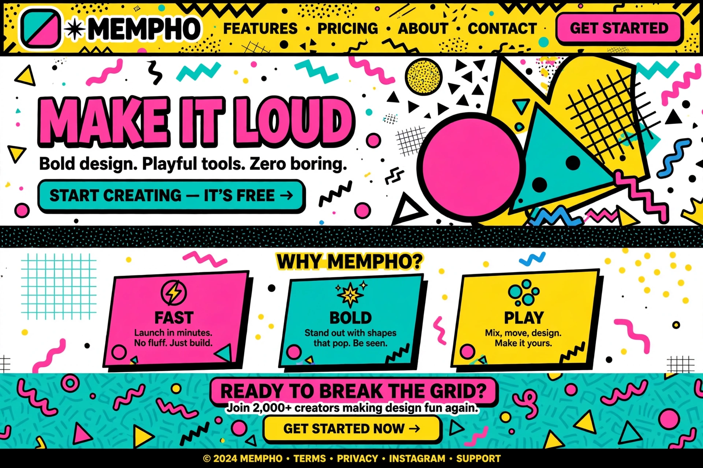
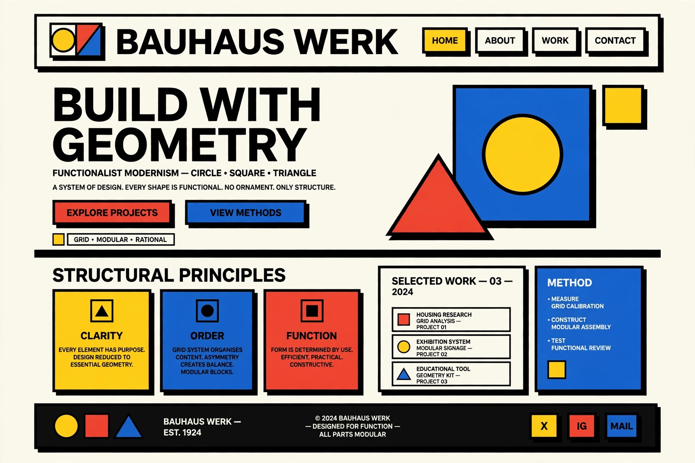

# 落地页官网

## AI 产品落地页 (`landing-ai-product`)

- 风格：深色 / 渐变光效 / 科技感
- 场景：AI 工具/SaaS 产品官网首屏
- 适用工具：v0、Lovable、Framer

**EN prompt（复制用）**

```
Design a high-converting landing page hero for an AI product: dark background with subtle aurora gradient glow, huge bold headline, one-line subheadline, email input + CTA button, product screenshot in a browser mockup with soft shadow and glow, logo wall of trusted companies below, then a 3-column feature section with icons. Modern tech aesthetic like Linear/Vercel, lots of whitespace, one accent color.
```

**中文说明**：AI 产品落地页：深色+极光渐变光效、大标题、邮箱输入+CTA、带光晕的产品截图、客户 logo 墙、三栏功能区，Vercel/Linear 感。

## 编辑杂志风品牌官网 (`landing-editorial`)

- 风格：大字体 / 留白 / 黑白
- 场景：设计工作室/独立品牌官网
- 适用工具：v0、Framer、Cursor

**EN prompt（复制用）**

```
Create an editorial, magazine-style brand website: off-white paper background, oversized serif headline typography, black and white palette with one red accent, asymmetric grid layout, large photography, numbered sections, fine hairline rules, generous whitespace, refined and confident like a print magazine brought to the web. No gradients, no rounded cards.
```

**中文说明**：杂志编辑风官网：米白纸感底、超大衬线标题、黑白+一点红、不对称网格、细线分割、大量留白，拒绝渐变和圆角卡片。

## 新丑风/粗野主义落地页 (`landing-brutalist`)

- 风格：新丑风 / 粗野主义 / 高对比
- 场景：潮流品牌/独立产品/活动页
- 适用工具：v0、Lovable

**EN prompt（复制用）**

```
Design a neo-brutalist landing page: raw white background, thick black borders (3px) on every element, hard offset shadows with no blur, bright clashing accent colors (yellow, hot pink, cyan), huge grotesque sans-serif headlines, marquee ticker strip, sticker-like badges rotated slightly, monospace details. Loud, playful, anti-corporate, but keep the grid aligned and readable.
```

**中文说明**：新丑风落地页：粗黑边框、无模糊硬阴影、黄/粉/青撞色、超大标题、跑马灯条、贴纸徽章，闹但网格要齐。

## Bento 便当网格功能区 (`landing-bento-grid`)


生成验证：✅ 2026-11-19 通过 — 生成图为 Lattice 功能区：6 格 Bento（1 大格仪表盘视觉+2 中格+3 小格）、16px 等距、20px 统一圆角、每格一标题一行文案一视觉、米白底白卡、靛蓝只在主格，通过

- 风格：Bento网格、卡片、极简
- 场景：SaaS/AI 产品功能展示区
- 适用工具：v0、Lovable、Framer

**EN prompt（复制用）**

```
Lay out the features section as a bento grid: 6 tiles of mixed sizes on a 12-column grid, one large 2x2 tile for the hero feature with a product visual, two medium tiles and three small tiles for supporting features, equal 16px gaps and unified 20px corner radius, each tile holds exactly one heading, one line of copy and one visual — no text walls. Light neutral background #F7F7F5, white tiles with 1px border #E7E5E4, one indigo accent only on the hero tile. Stack to a single column on mobile, keep tile order by importance.
```

**中文说明**：Bento 功能区：6 块大小不一的瓷砖、主功能占大格、统一 16px 间距和 20px 圆角、每格一标题一行文案一视觉，移动端单列堆叠。

## 瑞士极简网格官网 (`landing-swiss-minimal`)


生成验证：✅ 2026-11-20 通过 — 生成图为设计工作室官网：严格网格线可见、一种无衬线字体、近黑配米白、红色只用于主 CTA 与章节编号 02/03、超大左对齐标题、细线分隔、无阴影无渐变无圆角，通过

- 风格：瑞士极简、网格、黑白
- 场景：设计工作室/建筑/文化机构官网
- 适用工具：v0、Framer、Cursor

**EN prompt（复制用）**

```
Restyle this website in a minimal Swiss International style: strict 12-column grid with visible alignment, one sans-serif typeface (Helvetica/Inter) in only two weights (regular and bold), near-black text #111111 on off-white #FAFAF8, one red accent #E30613 used only for primary actions and section numbers. No shadows, no gradients, no rounded corners, no decorative icons. Oversized left-aligned headlines, generous margins, hairline rules to separate sections, everything snaps to the grid.
```

**中文说明**：瑞士极简：严格 12 栏网格、一种无衬线字体只用两档字重、近黑配米白、红色只给主操作，无阴影无渐变无圆角。

## SaaS 定价页三档对比 (`landing-pricing-saas`)


生成验证：✅ 2026-11-20 通过 — 生成图为 Forgeflow 定价页：月/年切换带 Save 20% 徽章、三卡等宽、Pro 卡 Most Popular 彩色边框微放大高亮、每卡人群说明+功能清单（不可用项灰显）、下方功能对比表齐全，通过

- 风格：定价、转化、卡片
- 场景：SaaS 订阅产品定价页
- 适用工具：v0、Lovable、Cursor

**EN prompt（复制用）**

```
Design a SaaS pricing page with 3 tiers (Starter, Pro, Team): short headline plus a monthly/annual toggle at the top with annual showing a 'Save 20%' badge; three equal-width cards with 24px gaps, the middle Pro card highlighted as 'Most Popular' with a colored border, slightly larger scale and a badge; each card shows plan name, price with billing period, one-line who-it-is-for, a primary CTA, and a feature checklist with checkmarks (unavailable features grayed out, not hidden). Below add a full feature-comparison table and an FAQ accordion. Background #FAFAF9, cards white with 1px border #E7E5E4, text #1C1917, one accent color only. No dark patterns, no hidden pricing.
```

**中文说明**：SaaS 定价页：月/年切换带省 20% 徽章、三卡等宽中间档高亮为最受欢迎、每卡含人群说明+功能清单、下方对比表+FAQ，无暗黑套路。

## 孟菲斯撞色落地页 (`landing-memphis`)



生成验证：✅ 2026-11-24 通过 — 生成图为孟菲斯风落地页：粉/黄/青撞色、圆/三角/波浪/网格几何图形、粗黑描边、超大几何标题 MAKE IT LOUD、倾斜色块功能卡配硬阴影、单一主 CTA，通过

- 风格：孟菲斯、撞色、几何
- 场景：创意/潮流品牌落地页想要 80 年代孟菲斯活力时
- 适用工具：v0、Lovable、Framer

**EN prompt（复制用）**

```
Design a landing page in Memphis style, the 80s Italian design movement: bold geometric shapes (circles, triangles, squiggles, grids), vivid contrasting colors (hot pink, yellow, teal, black), irregular playful patterns that break the grid, thick black outlines, oversized geometric headline type. Hero with a big geometric composition, feature cards as tilted color blocks with hard shadows, playful scattered shapes across sections. Keep the copy short and the layout energetic but readable; one clear primary CTA.
```

**中文说明**：孟菲斯风落地页：大胆几何图形+高饱和撞色+不规则图案+粗黑描边，活力十足但文案要短、主按钮唯一。

## 包豪斯几何官网 (`landing-bauhaus`)



生成验证：✅ 2026-11-24 通过 — 生成图为包豪斯风官网：只用圆/方/三角、粗黑边+硬偏移阴影、红蓝黄三原色+黑与米白、非对称布局、超大几何标题、无渐变无圆角，通过

- 风格：包豪斯、几何、现代主义
- 场景：设计/建筑/文化机构官网想要包豪斯现代主义时
- 适用工具：v0、Framer、Cursor

**EN prompt（复制用）**

```
Design a website in Bauhaus style: functionalist modernism built only from circles, squares and triangles, thick black borders, hard offset shadows, and pure Bauhaus primaries (red, blue, yellow) plus black and off-white. Asymmetric architectural layout, oversized geometric headline, grid-based sections, no gradients, no rounded corners, no decoration beyond geometry. Form follows function — every shape earns its place.
```

**中文说明**：包豪斯风官网：只用圆/方/三角+粗黑边+硬偏移阴影+红蓝黄三原色，非对称建筑感布局，无渐变无圆角。
