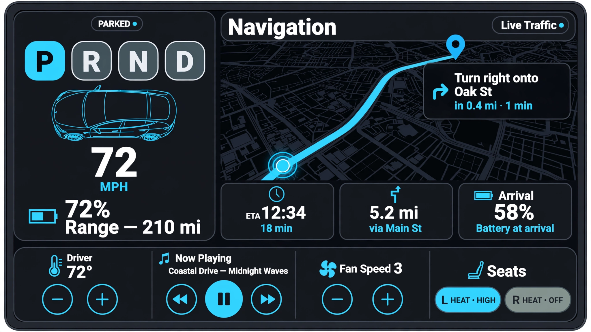

# 车机出行

## 车机中控屏：特斯拉风 (`car-infotainment-tesla`)



生成验证：✅ 2026-11-24 通过 — 生成图为特斯拉风车机中控：左 P R N D 档位+俯视线稿车+大字时速 72 MPH+电量 72%/续航 210 mi，右城市地图+蓝色路线+右转 Oak St 提示卡与 ETA，下坞温度/音乐/风速/座椅齐全，深色底+青色强调色，通过（小瑕疵：档位显示 PARKED 但时速表为 72 MPH，不影响布局特征）

- 风格：车机、深色、信息娱乐
- 场景：车机/中控大屏 UI 设计时
- 适用工具：v0、Lovable、Cursor

**EN prompt（复制用）**

```
Design a Tesla-style car infotainment screen, 1280x720 landscape touchscreen, plain HTML/CSS/JS, no photos: left third shows a top-down car in inline SVG, gear selector P R N D, large speed readout, battery percentage and range; right panel shows a stylised city map with a blue route line, next-turn card and ETA; bottom dock holds driver temperature, music controls, fan speed and seat controls. Colors: base #0B0D10, glass panels #15181D, borders #262B33, accent cyan #2FD3FF, text #E8ECF1. Big touch targets, glanceable while driving, no small text.
```

**中文说明**：特斯拉风车机中控：1280×720 横屏、左车况+中地图+下快捷坞，深色玻璃面板+青色强调色，驾驶时一眼可读。
