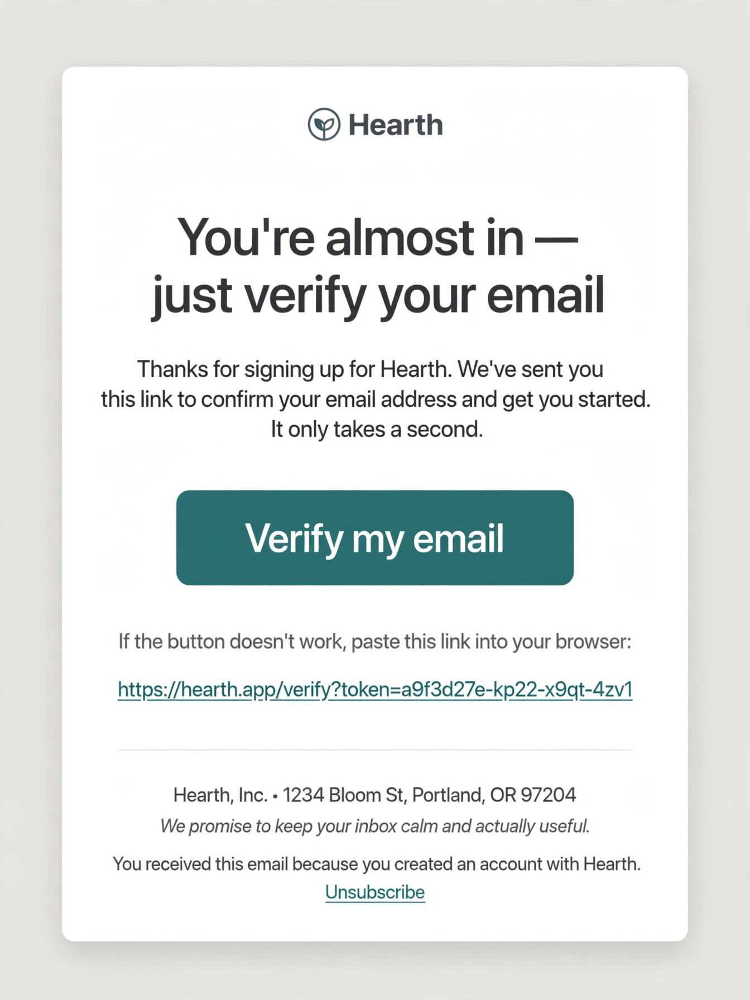

# 邮件模板

## 交易邮件模板：欢迎/验证 (`email-transactional`)



生成验证：✅ 2026-11-25 通过 — 生成图为交易验证邮件：单栏、顶部小 Logo、标题'You're almost in — just verify your email'、一段说明、一个青绿色主按钮'Verify my email'、按钮下纯文本备用链接、底部公司地址+退订齐全，通过

- 风格：邮件 / 交易邮件 / 极简
- 场景：欢迎/验证类交易邮件模板设计时
- 适用工具：v0、Lovable、Cursor

**EN prompt（复制用）**

```
Design a welcome / email-verification transactional email. Single-column layout, max 600px wide, works in dark and light mail clients. Structure: small logo at top, a clear headline, one short paragraph of context, one prominent primary button (the single action), a plain-text fallback link under it, and a simple footer (company, address, unsubscribe). Visual system: minimal, high-contrast, one brand color on the button only, system fonts, generous padding. Tone: warm and human, one sentence of personality. Avoid image-only emails, multiple competing CTAs, and tiny tap targets.
```

**中文说明**：交易邮件（欢迎/验证）：单栏 600px、一个主按钮+纯文本备用链接、系统字体、品牌色只用在按钮上，深浅邮件客户端都可用。
